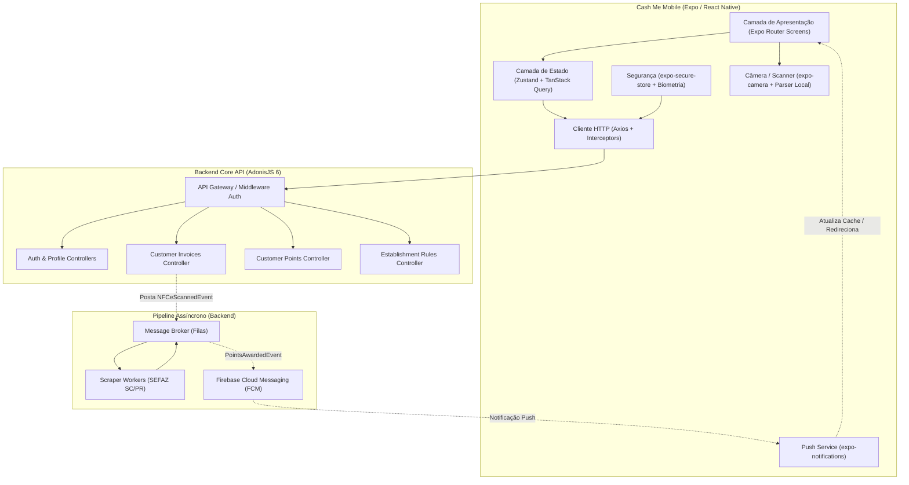

# Documento de Arquitetura de Software Mobile (Expo / React Native)
## Aplicativo Cash Me Mobile (`cash-me-mobile`)

---

## 1. Visão Geral e Propósito

O **Cash Me Mobile** é a aplicação cliente oficial para dispositivos móveis do ecossistema de fidelização Cash Me. O app atende a dois atores centrais do ecossistema através de perfis e interfaces dedicadas:

1. **Consumidor (`CUSTOMER`):** Escaneia QR Codes de notas fiscais de consumidor eletrônicas (NFC-e dos estados de SC e PR), acumula pontos automaticamente em estabelecimentos credenciados sem atrito no caixa, acompanha seus saldos por loja parceira, visualiza extratos detalhados e recebe notificações push em tempo real sobre o status do processamento fiscal.
2. **Lojista / Estabelecimento (`ESTABLISHMENT` / `LOJISTA_ADMIN`, `LOJISTA_OPERADOR`):** Gerencia a política de fidelidade de sua loja, simula regras de conversão (ex: R$ 1,00 = 1 pt ou R$ 10,00 = 1 pt), acompanha métricas essenciais e consulta os clientes fidelizados que já pontuaram no seu estabelecimento (com estrito respeito à privacidade e LGPD - RN08).

### Tecnologias Centrais
- **Framework:** React Native com **Expo SDK 52+** (Managed Workflow com suporte a Development Builds / Prebuild).
- **Roteamento:** **Expo Router v4+** (File-based routing com Route Groups e layout guards baseados em roles).
- **Linguagem:** **TypeScript 5+** com tipagem estrita e contratos sincronizados com a API backend AdonisJS 6.
- **Gerenciamento de Estado do Servidor:** **TanStack Query v5** (`@tanstack/react-query`) para cache inteligente, revalidação e mutações.
- **Gerenciamento de Estado Global do Cliente:** **Zustand v5** para sessão autenticada, tokens voláteis em memória e preferências.
- **Armazenamento Seguro:** **`expo-secure-store`** para persistência de tokens de acesso (`oat_...`) no Keychain (iOS) e Keystore (Android).
- **Cliente HTTP:** **Axios** com interceptors automáticos para injeção de Bearer Token e interceptação de 401 Unauthorized.
- **Design System e Estilização:** **Tailwind CSS / NativeWind v4** ou StyleSheet estruturado baseado nos tokens extraídos de `cash-me-front/CashMe` (Verde Esmeralda para Consumidor, Roxo Real para Lojista, Dourado para Pontos).
- **Captura Óptica / Câmera:** **`expo-camera`** para leitura instantânea de QR Code com parsing e validação offline antes do envio.
- **Push Notifications:** **`expo-notifications`** integrado ao Firebase Cloud Messaging (FCM).
- **Qualidade e Testes:** **Jest + React Native Testing Library** (Unitários/Integração) e **Maestro** (Testes E2E de ponta a ponta).

---

## 2. Topologia do Sistema e Comunicação

O aplicativo mobile opera em um modelo cliente-servidor conectado à API Core (AdonisJS 6) sob o prefixo `/api/v1`. Em conformidade com a arquitetura assíncrona orientada a eventos (EDD - ADR-001 e SDD do backend), o processamento de notas fiscais pode ser síncrono ou aceito assincronamente com retorno via Push Notification.



---

## 3. Estrutura de Diretórios do Projeto

A organização de código do projeto em `cash-me-mobile/` adota o padrão de arquitetura modular orientada a features (*Feature-First*), com clara separação entre navegação, serviços e componentes compartilhados:

```
cash-me-mobile/
├── assets/                          # Imagens, ícones de splash e fontes customizadas
├── docs/                            # Documentação técnica oficial e especificações
│   ├── architecture/                # SDD, rotas, segurança, estado e UI
│   └── tasks/                       # Backlog e especificações de tasks de desenvolvimento
├── src/
│   ├── app/                         # Roteamento baseado em arquivos (Expo Router)
│   │   ├── _layout.tsx              # Root Layout: Providers (Auth, Query, Notifications) + Route Guard
│   │   ├── index.tsx                # Splash/Entrypoint para redirecionamento inteligente
│   │   ├── +not-found.tsx           # Tela de fallback para rotas não mapeadas
│   │   ├── (auth)/                  # Route Group Público: Fluxo de Autenticação
│   │   │   ├── _layout.tsx          # Stack sem header
│   │   │   ├── login.tsx            # Login unificado
│   │   │   ├── signup-consumer.tsx  # Cadastro de Consumidor Global
│   │   │   └── signup-merchant.tsx  # Onboarding Atômico de Estabelecimento
│   │   ├── (consumer)/              # Route Group Protegido: Consumidor Final (Role: CUSTOMER)
│   │   │   ├── _layout.tsx          # Stack / Guard de proteção do Consumidor
│   │   │   ├── (tabs)/              # Navegação principal em abas (Bottom Tabs)
│   │   │   │   ├── _layout.tsx      # Barra de abas verde com ícones
│   │   │   │   ├── index.tsx        # Home: Resumo de saldos, atalhos rápidos e destaques
│   │   │   │   ├── wallet.tsx       # Carteira: Saldos agrupados por loja e histórico
│   │   │   │   ├── scan.tsx         # Leitor de QR Code / Scanner com viewfinder
│   │   │   │   ├── stores.tsx       # Exploração de Lojas Credenciadas
│   │   │   │   └── profile.tsx      # Perfil do Consumidor, Dados Cadastrais e Termos
│   │   │   ├── scan-manual.tsx      # Digitação manual da chave de 44 dígitos
│   │   │   ├── store/
│   │   │   │   └── [id].tsx         # Detalhes da Loja, Regra de Pontuação e Localização
│   │   │   ├── statement/
│   │   │   │   └── [id].tsx         # Extrato isolado do par Consumidor + Loja
│   │   │   └── invoice/
│   │   │       └── [id].tsx         # Detalhes da NFC-e processada e itens comprados
│   │   └── (merchant)/              # Route Group Protegido: Painel do Lojista (Role: LOJISTA_*)
│   │       ├── _layout.tsx          # Guard de proteção e verificação de status (ACTIVE vs PENDING)
│   │       ├── (tabs)/              # Navegação principal em abas do Lojista
│   │       │   ├── _layout.tsx      # Barra de abas roxa
│   │       │   ├── index.tsx        # Dashboard: Fator ativo, métricas de retenção e atalhos
│   │       │   ├── rules.tsx        # Gestão e Simulação de Regras de Pontos
│   │       │   ├── customers.tsx    # Clientes fidelizados da loja (RN08)
│   │       │   └── profile.tsx      # Perfil da Loja, CNPJ, Contato e Endereço
│   │       └── rules/
│   │           └── history.tsx      # Histórico versionado de regras anteriores
│   ├── components/                  # Componentes reutilizáveis
│   │   ├── common/                  # Botões, Inputs, Cards, Badges, Modais, Loaders
│   │   ├── consumer/                # Componentes exclusivos do consumidor (BalanceCard, QRScanner)
│   │   ├── merchant/                # Componentes exclusivos do lojista (RuleSimulator, MetricCard)
│   │   └── layout/                  # Header, ScreenWrapper com SafeArea, EmptyState
│   ├── constants/                   # Cores, espaçamentos, tipografia e temas
│   │   ├── theme.ts                 # Tokens de cores (G, GD, P, PD, GOLD, etc.)
│   │   └── config.ts                # Variáveis de ambiente e constantes de rede
│   ├── features/                    # Lógica de negócio isolada por domínio
│   │   ├── auth/                    # Hooks de login, cadastro, logout e biometria
│   │   ├── customer-invoices/       # Parser NFC-e, validação SEFAZ e envio de notas
│   │   ├── customer-points/         # Consultas de saldo, extratos e projeções
│   │   ├── establishments/          # Consulta de lojas parceiras e busca
│   │   └── merchant-rules/          # Simulador de regras, versionamento e regras ativas
│   ├── hooks/                       # Custom hooks genéricos (useNetInfo, useBiometrics, etc.)
│   ├── services/                    # Camada de integração externa
│   │   ├── api/                     # Instância Axios, interceptors e tratamento de erro
│   │   ├── storage/                 # Wrapper de SecureStore e MMKV/AsyncStorage
│   │   └── notifications/           # Configuração de push FCM e deep links
│   ├── stores/                      # Stores globais com Zustand
│   │   ├── useAuthStore.ts          # Sessão, token, perfil e status
│   │   └── useAppStore.ts           # Configurações globais e conectividade
│   ├── types/                       # Tipagens TypeScript compartilhadas
│   │   ├── auth.ts                  # User, UserType, CustomerProfile, EstablishmentProfile
│   │   ├── invoice.ts               # NfceData, NfceItem, ProcessInvoicePayload
│   │   ├── points.ts                # Balance, StatementTransaction, PointRule
│   │   └── establishment.ts         # Establishment, Address, RuleConfig
│   └── utils/                       # Utilitários puros
│       ├── formatters.ts            # Formatação de moeda BRL, CPF, CNPJ, datas
│       ├── nfceParser.ts            # Extração de chave de acesso, validação SEFAZ SC/PR
│       └── validators.ts            # Validadores Zod de formulários
├── .env.example                     # Exemplo de configuração de variáveis de ambiente
├── app.json                         # Configuração nativa Expo
├── package.json                     # Dependências do projeto
└── tsconfig.json                    # Configurações do compilador TypeScript
```

---

## 4. Pilares da Arquitetura

### 4.1. Expo Router & Controle de Acesso por Role (Guards)

O controle de rotas no app é 100% declarativo e baseado no estado de autenticação e no `userType`/`role` do usuário:

1. **Estado Anônimo (`!isAuthenticated`):**
   - Usuário é direcionado automaticamente para o grupo `(auth)`.
   - Se tentar acessar rotas em `(consumer)` ou `(merchant)`, o layout raiz intercepta e redireciona para `/(auth)/login`.
2. **Consumidor Autenticado (`user.userType === 'CUSTOMER'`):**
   - Direcionado automaticamente para `/(consumer)/(tabs)`.
   - Qualquer tentativa de acessar `/(merchant)` é bloqueada e redirecionada para a Home do Consumidor.
3. **Lojista Autenticado (`user.userType === 'ESTABLISHMENT'`):**
   - Direcionado para `/(merchant)/(tabs)`.
   - Se o cadastro do lojista estiver com `status === 'PENDING'` (RN06), o layout do lojista exibe um banner bloqueante/informativo instruindo sobre a homologação administrativa.
   - Tentativas de acessar a área do consumidor são redirecionadas para o painel do lojista.

### 4.2. Segurança e Ciclo de Vida de Tokens

- **Armazenamento Seguro:** O token opaco gerado pelo AdonisJS (`token.value.release()`, com prefixo `oat_...`) é armazenado exclusivamente via `expo-secure-store`. **Nunca** é utilizado `AsyncStorage` comum para credenciais sensíveis.
- **Cache em Memória:** Ao iniciar o app, a store Zustand carrega o token do SecureStore para a memória RAM garantindo leituras síncronas de altíssima performance para os interceptors do Axios.
- **Biometria:** Se habilitada pelo usuário, a chave do SecureStore pode ser protegida ou desbloqueada via `expo-local-authentication` (TouchID/FaceID/Biometria Android).
- **Logout Seguro:** Ao realizar logout, o app chama `POST /api/v1/account/logout` para revogar o token no banco de dados e limpa imediatamente o SecureStore e o estado do Zustand.

### 4.3. Cliente HTTP (Axios) e Resiliência de Rede

- **Injeção de Token:** Interceptor de requisição anexa o cabeçalho `Authorization: Bearer <token>` em todas as requisições autenticadas.
- **Tratamento de 401 Unauthorized:** Interceptor de resposta detecta expiração ou revogação de sessão, dispara a limpeza da store de autenticação e redireciona para a tela de login.
- **Mapeamento de Erros:** Erros retornados pelo AdonisJS (incluindo falhas de validação VineJS e exceções como `E_DUPLICATE_INVOICE`) são transformados em mensagens legíveis e amigáveis para o usuário.

### 4.4. Gerenciamento de Dados: TanStack Query + Zustand

- **Separação de Responsabilidades:**
  - **Zustand:** Gerencia o estado de sessão (usuário logado, perfil, token), preferências locais do dispositivo e conectividade de rede.
  - **TanStack Query:** Gerencia todo o ciclo de vida dos dados remotos (saldos, extratos, histórico de notas fiscais, lojas cadastradas e regras de pontuação).
- **Invalidação de Cache:** Ações como o processamento de uma nova NFC-e disparam a invalidação atômica das chaves `['balances']`, `['statement']` e `['invoices']`, assegurando que as telas reflitam imediatamente o novo saldo sem recarga completa.

### 4.5. Validação Local de NFC-e (Regras de Negócio no Edge)

Para poupar tráfego de rede e oferecer resposta instantânea (UX zero-delay), o app mobile inclui o módulo `utils/nfceParser.ts` que executa no dispositivo:
- **RN07 (Restrição Geográfica):** Validação de domínios SEFAZ autorizados (Santa Catarina `sat.sef.sc.gov.br` e Paraná `fazenda.pr.gov.br`).
- **RN02 (Chave de 44 dígitos):** Extração e checagem de formato da chave de acesso via regex antes do disparo HTTP.
- **RN01 (Janela de 48h):** Se a data de emissão estiver codificada na URL do QR Code, o app bloqueia notas com emissão superior a 48 horas antes mesmo de contactar o servidor.

---

## 5. Matriz de Conformidade com Regras de Negócio (RNs)

| Regra | Descrição | Implementação no Mobile |
|---|---|---|
| **RN01** | Validação de emissão (máx 48 horas) | Validação prévia em `nfceParser.ts` e tratamento do erro `E_INVOICE_EXPIRED` retornado pela API. |
| **RN02** | Unicidade da chave de 44 dígitos | Extração regex de 44 dígitos no leitor de QR Code; bloqueio de reenvio de chave idêntica já processada com tratamento do código `E_DUPLICATE_INVOICE`. |
| **RN03** | Vinculação automatizada via CNPJ | Mobile envia o payload extraído ou URL; o backend faz o match com o estabelecimento ativo. Mobile recebe o estabelecimento vinculado na resposta e atualiza o saldo da respectiva loja. |
| **RN04** | Regra de cômputo personalizável | Consumidor visualiza a regra humana da loja (ex: "R$ 10,00 = 1 ponto") e lojista dispõe de tela dedicada com simulador em tempo real e versionamento. |
| **RN05** | Proteção de saldo em lojista inadimplente | A tela de saldos e extratos do consumidor continua listando saldos históricos mesmo se o estabelecimento estiver inativo, sem ocultação de saldo adquirido. |
| **RN06** | Onboarding de lojistas pendente de aprovação | App exibe aviso informativo de conta em análise caso `status === 'PENDING'`. |
| **RN07** | Restrição geográfica (SC e PR) | Validação instantânea no scanner: QR Codes de outros estados são rejeitados com alerta visual antes do envio à API. |
| **RN08** | Privacidade de dados do consumidor | Na interface do lojista (`(merchant)/customers`), o mobile consome endpoint protegido que exibe apenas clientes que já pontuaram na loja em questão. |
