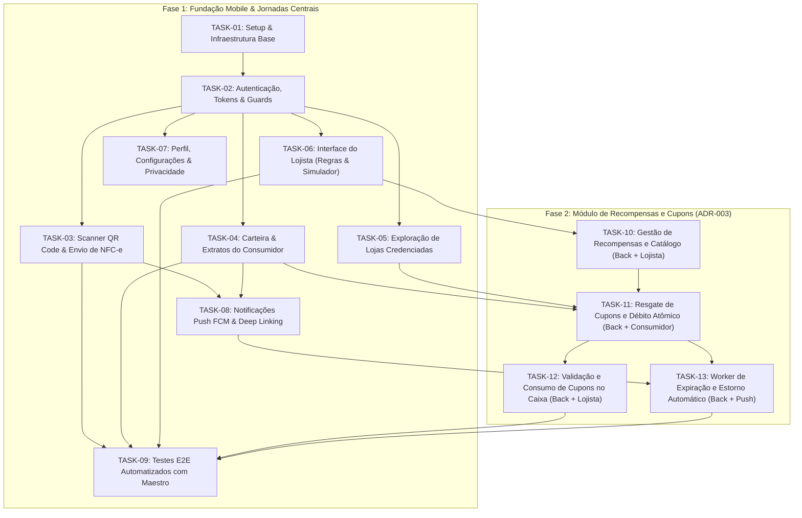

# Roadmap e Backlog de Tarefas do Cash Me Mobile & Fullstack
## Especificação Técnica de Tarefas de Desenvolvimento

---

## 1. Visão Geral e Estrutura de Execução

Este diretório contém as especificações detalhadas de todas as tarefas de desenvolvimento do **Cash Me Mobile** e sua integração com a API **Cash Me (AdonisJS v6)**. As tarefas estão divididas em duas fases:
- **Fase 1 (Tasks 01 a 09):** Fundação Mobile, Autenticação, Leitura de NFC-e, Carteira, Lojas, Regras do Lojista, Perfil, Push e Testes E2E.
- **Fase 2 (Tasks 10 a 13):** Módulo de Recompensas, Catálogo de Cupons, Resgate com Débito Atômico (`ADR-003`), Consumo no Caixa e Worker de Expiração/Estorno Automático.

---

## 2. Matriz de Tarefas e Dependências

---

## 3. Relação das Tasks

### Fase 1: Fundação Mobile & Jornadas Centrais

| Código | Título da Tarefa | Status | Dependências | Relação com Backend |
|---|---|---|---|---|
| **[TASK-01](./TASK-01-SETUP-E-INFRAESTRUTURA.md)** | Setup do Projeto, Design Tokens e Infraestrutura Base | `DONE` | Nenhuma | Configura client Axios para `/api/v1` |
| **[TASK-02](./TASK-02-AUTENTICACAO-E-ROLES.md)** | Autenticação, Armazenamento Seguro e Proteção por Role | `DONE` | TASK-01 | Consome `/auth/*` e `/account/*` (Tasks #1 e #2) |
| **[TASK-03](./TASK-03-LEITURA-QRCODE-E-PROCESSAMENTO-NFCE.md)** | Leitura de QR Code, Validação Local e Envio de NFC-e | `DONE` | TASK-02 | Consome `POST /customer/invoices/process` (Tasks #3, #4 e #5) |
| **[TASK-04](./TASK-04-CARTEIRA-E-EXTRATO-CONSUMIDOR.md)** | Carteira Digital, Saldos Isolados e Extratos de Pontos | `DONE` | TASK-02 | Consome `/customer/balances` e `/statement` (Task #5) |
| **[TASK-05](./TASK-05-EXPLORACAO-LOJAS-E-VITRINE.md)** | Catálogo de Lojas Parceiras e Detalhes de Fidelidade | `DONE` | TASK-01 | Consome `GET /establishments` (Task #1) |
| **[TASK-06](./TASK-06-INTERFACE-LOJISTA-REGRAS-E-SIMULADOR.md)** | Interface do Lojista: Regras, Simulador e Versionamento | `DONE` | TASK-02 | Consome `/establishment/loyalty-rule/*` (Task #6) |
| **[TASK-07](./TASK-07-PERFIL-CONFIGURACOES-E-PRIVACIDADE.md)** | Perfis de Usuário, Biometria, Termos e Privacidade | `BACKLOG` | TASK-02 | Consome `/account/*` e RN08 (Task #8) |
| **[TASK-08](./TASK-08-NOTIFICACOES-PUSH-E-DEEP-LINKING.md)** | Notificações Push com Expo / FCM e Deep Linking | `BACKLOG` | TASK-03, 04 | Integração com FCM (Task #9) |
| **[TASK-09](./TASK-09-TESTES-E2E-MAESTRO-E-QUALIDADE.md)** | Suíte de Testes Ponta a Ponta (E2E) com Maestro | `IN PROGRESS` | TASK-03..06, 11, 12 | Validação E2E de fluxos críticos |

### Fase 2: Módulo de Recompensas e Resgate de Cupons (ADR-003, RN09, RN10, RN11)

| Código | Título da Tarefa | Status | Dependências | Relação com Backend |
|---|---|---|---|---|
| **[TASK-10](./TASK-10-GESTAO-RECOMPENSAS-E-CUPONS.md)** | Gestão de Recompensas e Catálogo de Cupons | `READY` | TASK-01, 02 | Cria tabela `rewards` e endpoints `/establishment/rewards` (Task #10) |
| **[TASK-11](./TASK-11-RESGATE-CUPONS-E-DEBITO-ATOMICO.md)** | Resgate de Cupons no App Mobile e Débito Atômico | `BACKLOG` | TASK-04, 05, 10 | Cria `coupon_redemptions`, endpoints `/customer/rewards/:id/redeem` e `/coupons` (Task #11) |
| **[TASK-12](./TASK-12-VALIDACAO-E-CONSUMO-NO-CAIXA.md)** | Validação e Consumo de Cupons no Caixa | `BACKLOG` | TASK-11 | Endpoints `/establishment/coupons/verify` e `/consume` (Task #12) |
| **[TASK-13](./TASK-13-WORKER-EXPIRACAO-E-ESTORNO-AUTOMATICO.md)** | Worker de Expiração e Estorno Automático de Cupons | `BACKLOG` | TASK-08, 11 | Job `node ace coupons:expire` com estorno `REVERSAL` e Push (Task #13) |
