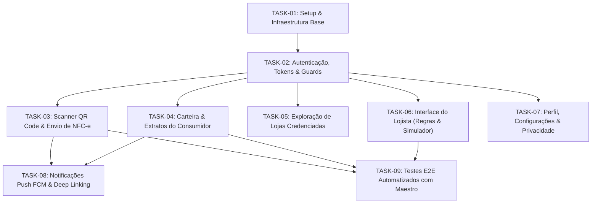

# Roadmap e Backlog de Tarefas do Cash Me Mobile
## Especificação Técnica de Tarefas de Desenvolvimento

---

## 1. Visão Geral e Estrutura de Execução

Este diretório contém as especificações detalhadas de todas as tarefas de desenvolvimento do **Cash Me Mobile**. As tarefas foram desenhadas de forma modular e sequencial, garantindo que cada entrega construa valor funcional sobre a camada anterior e mantenha perfeita sincronia com o ecossistema backend AdonisJS 6 (`cash-me`) e com os protótipos de interface (`cash-me-front`).

---

## 2. Matriz de Tarefas e Dependências

---

## 3. Relação das Tasks

| Código | Título da Tarefa | Dependências | Relação com Backend |
|---|---|---|---|
| **[TASK-01](./TASK-01-SETUP-E-INFRAESTRUTURA.md)** | Setup do Projeto, Design Tokens e Infraestrutura Base | Nenhuma | Configura client Axios para `/api/v1` |
| **[TASK-02](./TASK-02-AUTENTICACAO-E-ROLES.md)** | Autenticação, Armazenamento Seguro e Proteção por Role | TASK-01 | Consome `/auth/*` e `/account/*` (Tasks #1 e #2 do back) |
| **[TASK-03](./TASK-03-LEITURA-QRCODE-E-PROCESSAMENTO-NFCE.md)** | Leitura de QR Code, Validação Local e Envio de NFC-e | TASK-02 | Consome `POST /customer/invoices/process` (Tasks #3, #4 e #5 do back) |
| **[TASK-04](./TASK-04-CARTEIRA-E-EXTRATO-CONSUMIDOR.md)** | Carteira Digital, Saldos Isolados e Extratos de Pontos | TASK-02 | Consome `/customer/balances` e `/statement` (Task #5 do back) |
| **[TASK-05](./TASK-05-EXPLORACAO-LOJAS-E-VITRINE.md)** | Catálogo de Lojas Parceiras e Detalhes de Fidelidade | TASK-01 | Consome `GET /establishments` (Task #1 do back) |
| **[TASK-06](./TASK-06-INTERFACE-LOJISTA-REGRAS-E-SIMULADOR.md)** | Interface do Lojista: Regras, Simulador e Versionamento | TASK-02 | Consome `/establishment/loyalty-rule/*` (Task #6 do back) |
| **[TASK-07](./TASK-07-PERFIL-CONFIGURACOES-E-PRIVACIDADE.md)** | Perfis de Usuário, Biometria, Termos e Privacidade | TASK-02 | Consome `/account/*` e RN08 (Task #8 do back) |
| **[TASK-08](./TASK-08-NOTIFICACOES-PUSH-E-DEEP-LINKING.md)** | Notificações Push com Expo / FCM e Deep Linking | TASK-03, 04 | Integração com FCM (Task #9 do back) |
| **[TASK-09](./TASK-09-TESTES-E2E-MAESTRO-E-QUALIDADE.md)** | Suíte de Testes Ponta a Ponta (E2E) com Maestro | TASK-03, 04, 06 | Validação de ponta a ponta dos fluxos críticos |

---

## 4. Estrutura Padrão de Cada Documento de Tarefa

Cada arquivo de especificação segue rigorosamente a anatomia:
1. **Objetivo & Escopo:** Descrição concisa do que deve ser construído.
2. **Telas e Rotas Correspondentes:** Estrutura de arquivos no Expo Router.
3. **Endpoints da API do Backend Consumidos:** Métodos, URLs, cabeçalhos, contratos de envio e resposta.
4. **Regras de Negócio Aplicáveis:** Códigos de regras (RN01 a RN08) e ADRs impactadas.
5. **Critérios de Aceite (Acceptance Criteria):** Checklist verificável para validação da entrega.
